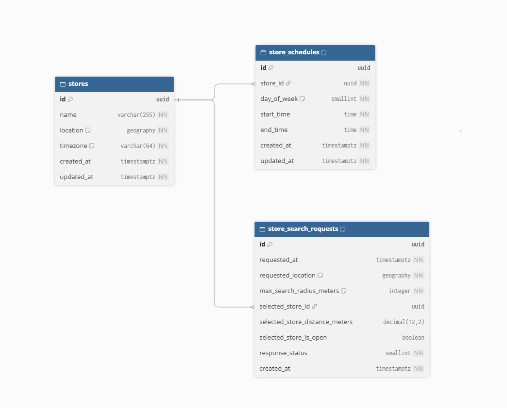

# InstaStore

## Table of Contents

- [Overview](#overview)
- [Local development](docs/LOCAL_DEVELOPMENT.md)
- [Proposal and Scope](#proposal-and-scope)
	- [In Scope](#in-scope)
	- [Out of Scope](#out-of-scope)
- [API](#api)
	- [Find the Closest Open Store](#find-the-closest-open-store)
- [Store Availability Algorithm](#store-availability-algorithm)
	- [Schedule Evaluation](#schedule-evaluation)
	- [Store Selection Flow](#store-selection-flow)
	- [Timezone and Complexity](#timezone-and-complexity)
- [Data Model](#data-model)
	- [stores](#stores)
	- [store_schedules](#store_schedules)
	- [store_search_requests](#store_search_requests)
	- [Geospatial Indexes](#geospatial-indexes)
- [Performance and Scaling](#performance-and-scaling)
- [Tradeoffs](#tradeoffs)
	- [PostgreSQL with PostGIS vs. MySQL](#postgresql-with-postgis-vs-mysql)
	- [Request-Time Availability vs. Persisted Status](#request-time-availability-vs-persisted-status)
	- [Store Response Availability vs. Audit Completeness](#store-response-availability-vs-audit-completeness)
- [Implementation Plan](#implementation-plan)
- [Success Metrics](#success-metrics)
	- [Business Metrics](#business-metrics)
	- [Technical Metrics](#technical-metrics)
- [Q&A](#qa)
- [Estimated delivery time](#estimated-delivery-time)

## Overview

InstaStore selects the closest convenience store that is currently open for a grocery delivery requested by a B2B client. The service exposes an API that accepts a delivery location and returns the selected store, its coordinates, and its availability status.

This document describes the initial scope, API contract, data model, selection algorithm, operational targets, tradeoffs, and delivery plan.

For prerequisites, Docker Compose startup, migrations, database seeding, API checks, tests,
and troubleshooting, see the [local development guide](docs/LOCAL_DEVELOPMENT.md).

## Proposal and Scope

Build a stateless HTTP service with **Node.js, TypeScript, and NestJS**, backed by **PostgreSQL with PostGIS**. Store locations and recurring store schedules are persisted in the database. The service evaluates whether a store is open at request time; availability is derived from the schedule and the store's IANA timezone, not stored as mutable state.

### In Scope

- An endpoint for B2B clients to find the closest currently open store for a latitude/longitude pair.
- Geographic distance calculation and nearby-store search using PostGIS.
- On-demand `isOpen` evaluation using each store's weekly schedule and timezone.
- Persistence of endpoint search calls and their outcomes for operational and business analysis.
- Database indexes and Docker Compose configuration needed to run the service locally.

### Out of Scope

- Authentication and authorization of B2B client requests. These are assumed to be handled by an upstream gateway or platform layer.
- Endpoints to create or update store or schedule information. Store data is assumed to be managed through a separate process.
- Endpoints to retrieve stores by ID or name.
- An endpoint to retrieve search-request audit records.
- Store inventory checks or other availability rules beyond operating hours.

## API

### Find the Closest Open Store

```http
GET /v1/stores/closest?latitude={latitude}&longitude={longitude}
```

Query parameters:

| Parameter | Type | Required | Description |
| --- | --- | --- | --- |
| `latitude` | number | Yes | WGS 84 latitude, from -90 to 90. |
| `longitude` | number | Yes | WGS 84 longitude, from -180 to 180. |

Example request:

```http
GET /v1/stores/closest?latitude=4.7110&longitude=-74.0721
```

Successful response (`200 OK`):

```json
{
	"storeId": "3fa85f64-5717-4562-b3fc-2c963f66afa6",
	"storeName": "Central Convenience",
	"isOpen": true,
	"coordinates": {
		"latitude": 4.7112,
		"longitude": -74.0718
	}
}
```

The endpoint selects only stores open at the time of the request, so `isOpen` is `true` for a successful response. The field remains in the response contract to state availability explicitly. The selected store's distance is recorded for analysis but is not returned in this initial API version.

Errors:

| Status | Meaning |
| --- | --- |
| `400 Bad Request` | A coordinate is missing, non-numeric, or outside its valid range. |
| `404 Not Found` | No open store is available for the requested location. |
| `503 Service Unavailable` | The service cannot complete the store search because a required dependency is unavailable. Audit persistence failures alone do not produce a `503`. |

Error response body:

```json
{
	"statusCode": 404,
	"message": "No open store is available for the requested location"
}
```

## Store Availability Algorithm

Store availability is calculated at request time. For a fixed store schedule, timezone, and reference instant, the result is deterministic. The application receives one reference `Instant` per request and uses it for every schedule evaluation in that search.

### Schedule Evaluation

Each schedule interval is a recurring range described by `day_of_week`, `start_time`, and `end_time`. Times are local to the store's configured IANA timezone, for example `America/Bogota`. Weekdays use ISO numbering: Monday is 1 and Sunday is 7.

A store with no configured schedule intervals is considered unavailable: `isOpen` is `false`. Missing schedule data is not interpreted as unrestricted opening hours, so incomplete store configuration cannot make a store eligible for selection.

1. Convert the request's reference instant to a zoned date-time in the store's timezone.
2. Extract the store-local weekday and time.
3. Get the schedule intervals for that weekday.
4. Check whether the local time falls in any interval.
5. Return `true` if it does, otherwise return `false`.

Intervals use half-open boundaries, `[start_time, end_time)`: the start is inclusive and the end is exclusive. Thus, for a Wednesday interval from `08:00` to `20:00`, the store is closed at `07:59`, open at `08:00` and `14:30`, and closed at `20:00`.

Overnight schedules are normalized across calendar days when schedule data is created. For example, Friday `22:00` through Saturday `02:00` is stored as Friday `22:00` to midnight and Saturday midnight to `02:00`. Each stored interval has `start_time < end_time`, so evaluation does not need special overnight logic. Schedule-management endpoints are out of scope; the process that loads schedule data must apply this normalization.

```text
isOpenAt(store, instant):
		localDateTime = instant.atZone(store.timezone)
		localDay = localDateTime.dayOfWeek
		localTime = localDateTime.toLocalTime()

		intervals = store.schedules where schedule.dayOfWeek == localDay

		return any(interval in intervals where
				interval.startTime <= localTime
				and localTime < interval.endTime
		)
```

### Store Selection Flow

1. Validate the requested latitude and longitude, load the configured maximum radius, and capture the reference instant.
2. Use PostGIS `ST_DWithin` to retrieve every store within that radius, ordered by exact distance from the requested coordinates.
3. Evaluate each candidate's schedule in nearest-first order, converting the same reference instant into that store's timezone.
4. Select the first candidate that is open. Because all candidates within the configured radius are ordered by distance, this is the nearest open store within the radius.
5. Return the selected store, or return `404` if no candidate is open within the radius; do not select a store beyond the configured limit. Submit the request outcome for best-effort audit persistence without making response delivery depend on that write.

`MAX_STORE_SEARCH_RADIUS_KM` is a global service configuration setting, not a per-request parameter. The initial default is **10 km**. We will evaluate search outcomes, including no-store rates and selected-store distances, to determine whether this radius meets coverage needs across delivery areas. The appropriate value depends on store density and acceptable customer travel distance; it may need adjustment, particularly in lower-density areas. Keep the radius snapshot in each audit record so historical results remain interpretable after configuration changes. Per-region configuration can be considered later if metrics show materially different coverage needs by city or region.

Example PostGIS candidate query (the application evaluates schedules in the returned nearest-first order):

```sql
SELECT
	id,
	name,
	ST_Distance(
		location,
		ST_SetSRID(ST_MakePoint(:longitude, :latitude), 4326)::geography
	) AS distance_meters
FROM stores
WHERE ST_DWithin(
	location,
	ST_SetSRID(ST_MakePoint(:longitude, :latitude), 4326)::geography,
	:max_radius_meters
)
ORDER BY distance_meters ASC;
```

`ST_DWithin` filters candidates in the database using the configured maximum radius, while `ST_Distance` ranks them. This is straight-line geographic distance, not driving distance or estimated delivery travel time. Schedule evaluation remains in the application because it depends on IANA timezone rules. No arbitrary small candidate limit should be applied: a closer closed store must not prevent consideration of a farther open store that is still within the configured radius.

### Timezone and Complexity

Schedule evaluation uses the configured IANA timezone, not UTC weekday/time fields. This handles stores in different timezones and daylight-saving transitions according to the timezone database. The application clock should be injectable so tests can evaluate boundary cases and timezone transitions with a fixed instant.

A full scan evaluating `N` stores with `K` schedule intervals per candidate has worst-case complexity `O(N × K)`. The GiST spatial index and configured maximum radius reduce the candidate set in typical requests. Candidate distances are straight-line geographic distances computed by PostGIS in meters.

## Data Model

<p width="100%" align="center"></p>

Each schedule belongs to one store. A search request may have no selected store when no open store is found; when selected, it references one store. The optional store-to-request relationship is therefore represented as nullable on `store_search_requests.selected_store_id`.

### `stores`

Stores represent physical convenience stores available for delivery.

| Field | Type | Description |
| --- | --- | --- |
| `id` | UUID | Unique store identifier; primary key. |
| `name` | VARCHAR(255) | Store name. |
| `location` | GEOGRAPHY(POINT, 4326) | WGS 84 store coordinates, indexed for spatial queries. |
| `timezone` | VARCHAR(64) | IANA timezone identifier, such as `America/Bogota`. |
| `created_at` | TIMESTAMPTZ | Record creation timestamp. |
| `updated_at` | TIMESTAMPTZ | Last update timestamp. |

### `store_schedules`

Each row represents one recurring interval on one local weekday. Multiple intervals per day are supported.

| Field | Type | Description |
| --- | --- | --- |
| `id` | UUID | Unique schedule identifier; primary key. |
| `store_id` | UUID | Reference to `stores.id`. |
| `day_of_week` | SMALLINT | Local weekday: 1 = Monday through 7 = Sunday. |
| `start_time` | TIME | Inclusive interval start in the store's local timezone. |
| `end_time` | TIME | Exclusive interval end in the store's local timezone. |
| `created_at` | TIMESTAMPTZ | Record creation timestamp. |
| `updated_at` | TIMESTAMPTZ | Last update timestamp. |

Intervals follow `[start_time, end_time)` and are normalized across days for overnight opening hours. Index `(store_id, day_of_week)` to retrieve a store's schedule efficiently.

### `store_search_requests`

This table records endpoint calls and their outcomes for auditing and business analysis. Fields describing the selected store are nullable when no store is selected.

| Field | Type | Description |
| --- | --- | --- |
| `id` | UUID | Unique search request identifier; primary key. |
| `requested_at` | TIMESTAMPTZ | Instant at which the search was performed. |
| `requested_location` | GEOGRAPHY(POINT, 4326) | Customer's requested delivery coordinates. |
| `max_search_radius_meters` | INTEGER | Snapshot of the configured maximum radius used for this request. |
| `selected_store_id` | UUID, nullable | Selected `stores.id`, if any. |
| `selected_store_distance_meters` | DECIMAL(12,2), nullable | Distance from requested location to selected store. |
| `selected_store_is_open` | BOOLEAN, nullable | Whether the selected store was open when evaluated. |
| `response_status` | SMALLINT | HTTP status returned by the endpoint. |
| `created_at` | TIMESTAMPTZ | Record creation timestamp. |

Attempt to persist the outcome for successful and no-store searches, including the configured radius. Audit persistence is best-effort and must not block or change the store-selection response: if an audit write fails, return the selected store (or the normal no-results response), and emit an error log and metric for the failed write. This prioritizes store-availability information for the B2B client over completeness of audit records; some audit records may be missing during persistence failures. Authentication data and client identity are not included because request authentication is out of scope.

### Geospatial Indexes

Enable PostGIS and add a GiST index for store candidate searches. A GiST index on historical requested locations is optional and should be added only if query patterns require geospatial analysis of audit records.

```sql
CREATE EXTENSION IF NOT EXISTS postgis;

CREATE INDEX idx_stores_location
		ON stores
		USING GIST (location);

CREATE INDEX idx_store_schedules_store_day
		ON store_schedules (store_id, day_of_week);
```

## Performance and Scaling

- **Latency target:** respond within 300 ms at the 95th percentile under the target workload. This is an initial service-level objective to validate in load testing, not a measured guarantee.
- **Throughput estimate:** support 500 requests per second across the service deployment. Validate this estimate with representative store density, schedule data, database sizing, and audit-write volume.
- **Database:** use the spatial index to limit candidate work; use connection pooling and inspect query plans and index usage under load. Keep schedule reads and audit writes bounded and indexed as appropriate.
- **Application:** keep instances stateless so HTTP capacity can scale horizontally. Apply request timeouts and database connection limits to avoid overload amplification.
- **Measurement:** track latency percentiles, throughput, error rates, candidate counts, database query time, and audit-write time. Load-test both dense and sparse store regions, including searches that find no open store.

The latency target includes validation, geographic search, schedule evaluation, and response serialization. Audit persistence should be dispatched outside the critical response path and measured separately. Scaling policy and database capacity should be set from load-test results rather than inferred from the request-rate estimate alone.

## Tradeoffs

### PostgreSQL with PostGIS vs. MySQL

PostgreSQL with PostGIS is proposed because it provides mature geographic types, distance functions, spatial predicates, and GiST indexing in the same database as the relational store and schedule data. This keeps the initial architecture to one persistence system and lets candidate filtering and distance calculation run close to the data.

MySQL also supports spatial types and indexes, so it could meet the use case. The choice favors PostGIS's established geospatial capabilities and operator ecosystem; it is not a claim that MySQL cannot perform the required queries. The team should verify operational familiarity, managed-service availability, and query-plan behavior before committing to a production deployment.

### Request-Time Availability vs. Persisted Status

Deriving `isOpen` at request time avoids stale status when time advances or schedules change and naturally accounts for each store's timezone. The tradeoff is schedule evaluation per request; this is expected to be inexpensive and is preferable to maintaining a mutable status that can drift from the schedule.

### Store Response Availability vs. Audit Completeness

The endpoint prioritizes returning the closest eligible store over recording every search call. Audit writes are best-effort and must not delay or fail an otherwise successful store response; audit-write failures are logged and measured, but can result in missing records. This reduces audit completeness in exceptional persistence failures in exchange for keeping the client-facing store-selection capability available. A durable asynchronous queue can reduce the loss window, but adds infrastructure and still requires an explicit delivery and retention guarantee; it must not become a dependency for returning the selected store.

## Implementation Plan

| Step | Deliverable |
| --- | --- |
| 1. Scaffolding and basic setup | Create the NestJS/TypeScript service, configuration and health checks; establish PostgreSQL/PostGIS connectivity, migrations, and automated test conventions. |
| 2. Containerization | Create a Dockerfile and Docker Compose configuration to run the service and PostgreSQL/PostGIS locally, including the required environment configuration and health checks. |
| 3. Store and schedule data access | Implement the `stores` and `store_schedules` schema, constraints, spatial/schedule indexes, and repository queries for candidate locations and schedules. |
| 4. Closest available store endpoint | Implement coordinate validation, PostGIS candidate search within the configured maximum radius, timezone-aware schedule evaluation, nearest-open selection, response serialization, and unit/integration tests. |
| 5. Save endpoint request calls | Add best-effort persistence for successful and no-store outcomes, including requested location, radius, selected store/distance/open status, and HTTP status; verify audit failures are observable and never change the endpoint response. |
| 6. Performance and local validation | Run tests for the 300 ms latency and 500 req/s targets where the local environment permits, verify end-to-end behavior, and document local startup and test procedures. |

## Success Metrics

### Business Metrics

- Percentage of valid searches that return an open store within the configured radius.
- No-store response rate by requested area and time of day, to identify store coverage or schedule gaps.
- Distribution of selected-store distances and searches near the radius limit, to assess radius suitability and detect unexpectedly distant selections.
- Correctness of nearest-open-store selection and reported availability, measured through sampled comparisons with candidate distances and source schedules.

### Technical Metrics

- Endpoint latency: p50, p95, and p99, with p95 at or below 300 ms under the agreed target workload.
- Throughput and resource saturation: requests per second, CPU and memory utilization, database connections, and request queueing at 500 req/s.
- Endpoint reliability: successful response rate, 5xx rate, timeout rate, and service availability, including searches with no eligible store.
- Search efficiency: PostGIS candidate-query duration, candidate count, and schedule-evaluation time per request.
- Audit health: write latency and failure rate, plus the estimated number of requests without an outcome record; audit failures must not increase endpoint errors.
- Data health: stores with invalid timezones, missing locations, or invalid schedule intervals that could affect selection.

Targets should be baselined during load testing and reviewed against production traffic before they are treated as committed SLOs.

## Q&A

| Question | Answer |
| --- | --- |
| Is there a maximum distance from the requested coordinates for a store to qualify for delivery, or should the endpoint return the closest qualifying store regardless of distance? | There are no previously required limits, but it is good if you propose something that makes sense for or protects your solution. |
| Should the endpoint return the closest store that is currently open, or the geographically closest store regardless of its opening status, with isOpen indicating whether it is currently open? | It would be good if you take into account if the store is available in order to select it. |
| Is there an existing dataset of stores available for this challenge, or should I create sample data to populate the database? | You should create sample data to populate that allows you to test the use cases that you need. |
| I'm assuming “schedule strategy” in the Architecture Commit instructions refers to how store operating hours are represented and evaluated. Is that correct? | It is not, it refers on how it is going to be your schedule of development of your solution. |

## Estimated delivery time

Friday, October 16, 2026

## Improvements and Trade-offs

### 1. What would you improve in your code if you had more time? Why?

The core endpoint, schema, dynamic `isOpen` calculation, tests, Docker setup, and local performance tooling are implemented. With more time, I would improve:

- Discuss the need for audit writes for requests made to the endpoint. If this is a non-negotiable business requirement, use a more optimal strategy, such as replacing awaited audit writes with a durable queue or batch writer. Awaiting the write makes its cost visible and preserves the best-effort response contract, but it also adds database work to the request-latency path.
- Increase coverage of edge-case scenarios in store selection.
- Add query-duration, candidate-count, schedule-evaluation, and audit-write metrics so latency bottlenecks can be separated precisely.
- Make the seed process idempotent and provide a repeatable performance environment with larger, production-like data volumes.
- Add production safeguards such as authentication, authorization, rate limiting, timeouts, and stronger deployment defaults.

### 2. What trade-offs did you make to deliver this project on time? What would you do next time to deliver more and sacrifice less?

To deliver on time, I kept the scope focused on the core closest-open-store flow. I treated authentication, store-management APIs, and production deployment as responsibilities of other systems, and chose PostgreSQL/PostGIS and Docker Compose to deliver geographic search and local reproducibility quickly. I also kept audit persistence best-effort and used bounded metric dimensions to avoid unnecessary complexity and high-cardinality telemetry.
Next time, I would clarify system ownership and non-functional priorities earlier, delegate features that belong in surrounding systems, and reserve more time for representative performance testing and production hardening. This would let me deliver more operational confidence without expanding the core service unnecessarily.

### 3. How secure do you consider your service? Why?

For the scope of this challenge, the service has a reasonable security baseline: it validates coordinates, uses parameterized SQL queries, relies on PostgreSQL constraints and foreign keys, keeps secrets in environment variables, avoids committing `.env`, and runs the production container as a non-root user.

Additional controls like authentication and authorization could be delegate to a common upstream gateway, depending on how we plan to deploy the service.

### 4. What would you do to measure the behavior of your product in a production environment?

I would combine exiting metrics implemntation with database measurements and controlled operational review:

- Track request rate, p50/p95/p99 latency, 4xx/5xx rates, timeouts, dropped requests, and availability by endpoint and deployment version.
- Track found-store rate, no-store rate by bounded area and time bucket, selected-distance distributions, searches near the configured radius, and audit-write failures. The current implementation already emits the search counts, distance summary, radius-proximity count, and error counts; audit failure metrics should be added alongside the existing logs.
- Monitor PostgreSQL pool usage, connection waits, active queries, PostGIS query duration, WAL and commit latency, CPU, memory, disk, locks, and database connection saturation.
- Compare observed results with the k6 baseline and repeat load tests after changes to indexes, pool size, store density, or scheduling data.
- Sample successful selections independently to verify nearest-open-store correctness and detect data-quality problems such as invalid timezones, missing locations, or malformed schedules.
- Define alerts and service-level objectives only after establishing a baseline from representative production traffic, then review the metrics by city, time of day, release, and infrastructure configuration.
